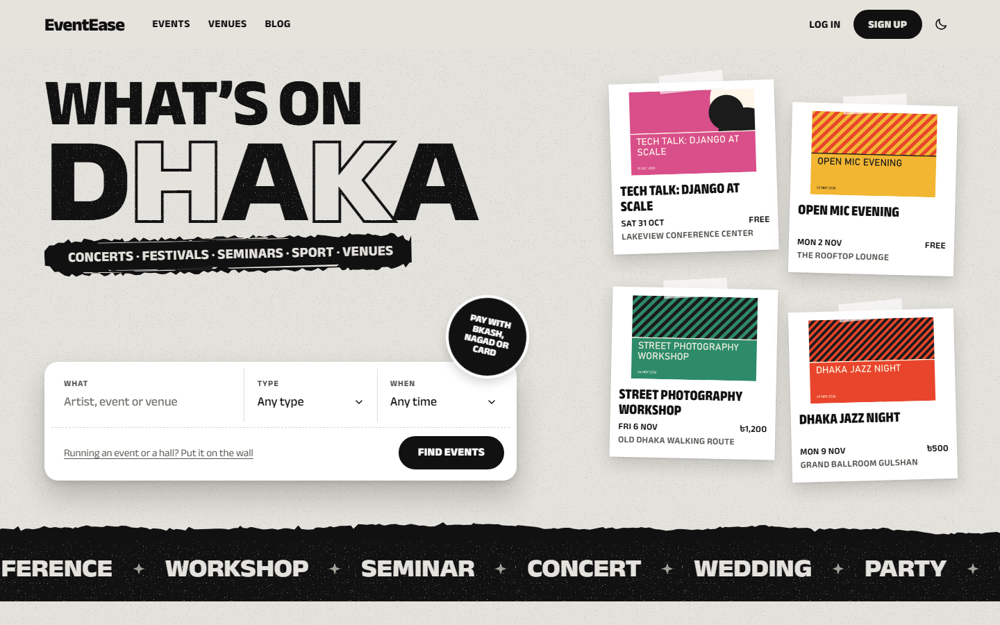

# EventEase



EventEase is a Django web app for discovering and booking events and venues. Attendees buy tickets, organisers run events and book venues, venue managers approve bookings, and admins moderate the platform. Payments go through SSLCommerz (bKash, Nagad and cards).

## Features

- **Events**: browse and filter, ticket tiers, booking, downloadable PDF tickets with a QR code, and a public ticket check page
- **Venues**: listings with images and pricing, availability, booking requests, approval, and invoices
- **Payments**: SSLCommerz, bKash and Nagad, with a sandbox store for development
- **Reviews and comments**: event and venue reviews, threaded comments with likes, and admin moderation
- **Social**: friends, direct messages with file attachments, and in-app notifications
- **Blog**: posts, comments and reactions
- **Roles**: Basic User, Event Manager, Venue Manager and Admin, with a role-upgrade request flow and a dashboard for each
- **Interface**: responsive, with light and dark mode

## Tech stack

Python 3.12 · Django 5.2 · SQLite · Pillow · ReportLab · qrcode · requests

## Getting started

```bash
python -m venv .venv
.venv\Scripts\activate          # macOS/Linux: source .venv/bin/activate
pip install -r requirements.txt
python manage.py migrate
python manage.py seed_demo --yes
python manage.py runserver
```

Open http://127.0.0.1:8000/. `seed_demo` fills the database with demo accounts in every role, venues, events, bookings, payments, reviews and blog posts, and prints the logins when it finishes. To start empty instead, skip it and run `python manage.py createsuperuser`.

`seed_demo --yes` deletes all existing data first.


## Project layout

```
config/          Settings (base, development, production), root URLs, WSGI/ASGI
apps/
  users/         Auth, profiles, roles, dashboards, friends, messaging
  events/        Events, ticket categories, bookings, comments, tickets
  venues/        Venues, venue bookings, invoices, comments
  reviews/       Event and venue reviews, moderation
  payments/      Payment flow, SSLCommerz, platform revenue
  notifications/ In-app notifications
  blog/          Posts, comments, reactions
  core/          Home page, demo data generator
templates/       Django templates
static/          CSS and JS
```
